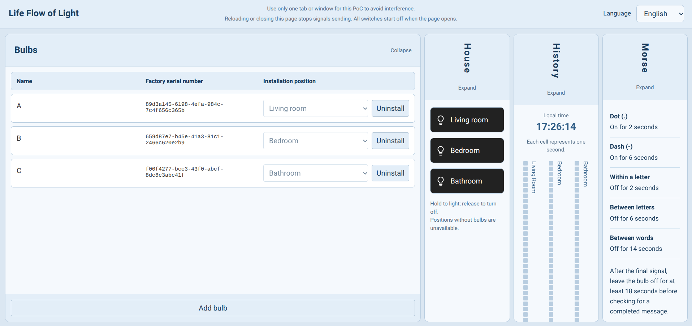
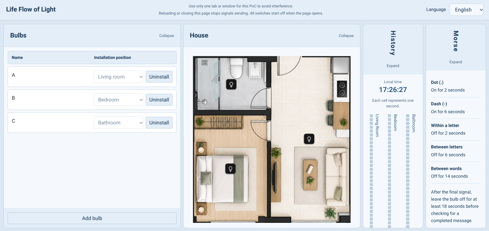
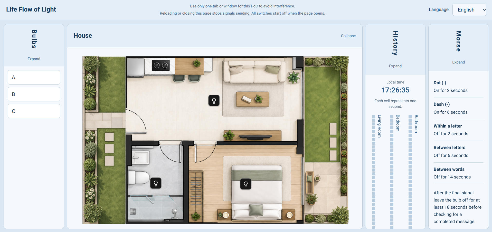
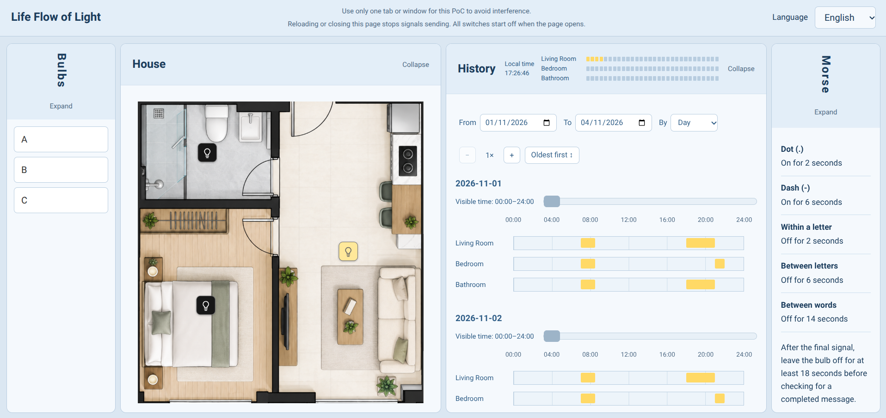
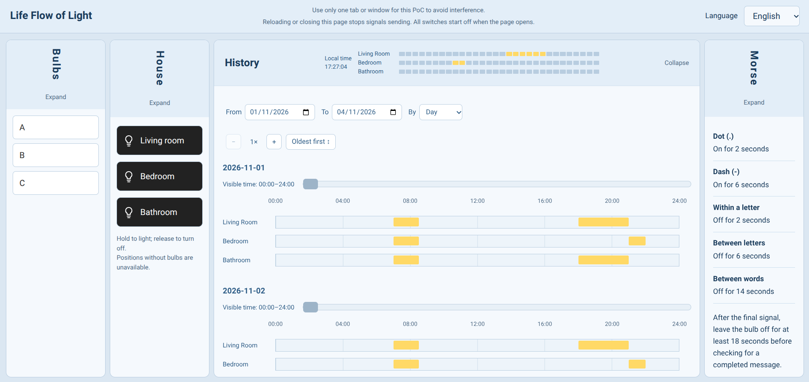
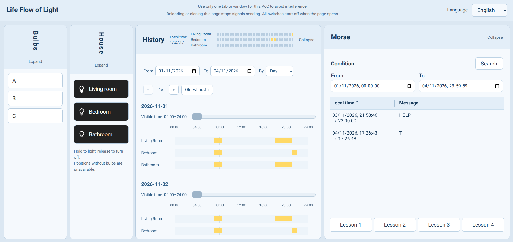
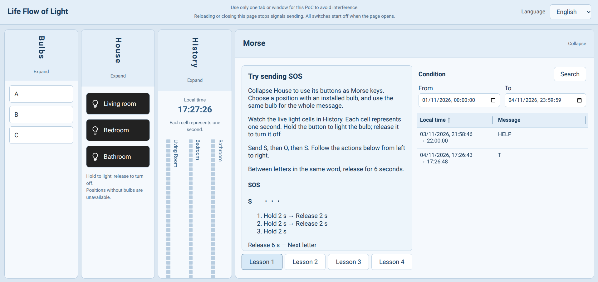
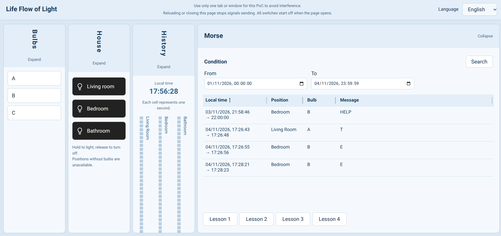

# Life Flow of Light — Visual Guide

[繁體中文](VisualGuide.zh-TW.md) | [Back to README](../README.md)

## Demo Video

[Watch the video demo on YouTube](https://youtu.be/QOIn_nDP72g)

> For clearer interface text, watch in full screen and set the YouTube video quality to **1080p**.

Life Flow of Light is a proof of concept (PoC) that explores how lighting records can help us observe activity at home. You can simulate room lights in your browser, review their usage history, and experiment with sending Morse code through light signals.

The current demo uses software simulation. No physical bulbs or sensors are required.

## How Is the Interface Organised?

The application uses a single page with four panels in a fixed order:

**Bulbs → House → History → Morse**

You can expand two panels side by side to operate one while observing another. When only one panel is expanded, it uses the full width. The panel order stays the same, and at least one panel remains expanded.

The four screenshots below introduce each panel and explain how they work together.

## 1. Bulbs: Prepare the Lights

The Bulbs panel manages the bulbs in the simulated environment. You can:

- Add bulbs and rename them.
- Install a bulb in the living room, bedroom, or bathroom.
- Uninstall a bulb to return it to an idle state.
- Delete an uninstalled bulb that has no usage history.

Each position can hold only one bulb. A bulb cannot be uninstalled while its light is on. Switch it off first and allow a short moment for the system to recognise that it is inactive.

**How it connects to the other panels**

The installation positions determine which lights you can operate in House. A room without an installed bulb has no usable light switch.

Adding, installing, uninstalling, or deleting a bulb reloads the page and returns all lights to the off state. Renaming a bulb does not reload the page.

## 2. House: Simulate Everyday Lighting

The House panel displays a floor plan with a living room, bedroom, and bathroom. Click a room's switch to turn its installed bulb on or off.

You can act out an everyday routine: switch on the living room light when entering, switch it off when leaving, and then turn on the bedroom light.

When House is collapsed, it also provides controls that keep a light on while you hold the button and turn it off when you release it. These are useful for practising the duration of light signals.

**How it connects to the other panels**

Bulbs determines which lights are available here. The lighting activity you create in House becomes data that History and Morse can query.

Use only one browser tab or window to operate this PoC, so signals from multiple windows do not interfere with one another. Reloading the page returns all lights to the off state.

## 3. History: See When Lights Were Used

The History panel presents lighting records on a timeline, allowing you to see when lights were used in different positions.

You can:

- Select a start date and an end date.
- Group records by day or position.
- Adjust the timeline zoom and scroll horizontally through time.
- Hover over a record to view more details.

If you have loaded the sample data supplied with the project, you can explore those records immediately without collecting several days of activity yourself.

**How it connects to the other panels**

Switching lights on and off in House creates records that you can later query here by date.

Each historical record keeps the position where the activity happened. Moving a bulb to another room does not move its earlier records to the new position.

This panel displays lighting activity. It does not assess a resident's health or send alerts.

## 4. Morse: Read Light Patterns as Text

The Morse panel explores another use for lighting records: expressing letters and words through the duration of light and darkness.

It provides guided practice, starting with SOS and A–Z, followed by a sentence and independent signalling. Follow the instructions, operate a light in the same room throughout your message, and then select the relevant date and time range to query the decoded results.

The suggested practice timings are:

- Dot: light on for 2 seconds.
- Dash: light on for 6 seconds.
- Gap between signals within one letter: light off for 2 seconds.
- Gap between letters: light off for 6 seconds.
- Gap between words: light off for 14 seconds.

Each gap is the complete duration for that situation; do not add the gaps together. After the final signal, keep the light off for at least 18 seconds before checking the result.

**How it connects to the other panels**

House is where you enter the light signals. History lets you inspect the lighting intervals. Morse attempts to recognise text from those records.

If you have loaded the sample data, you can also look for its prerecorded HELP signal. This is a decoding demonstration; it does not contact emergency services or notify anyone.

## What Next?

- To run the project on your computer: [User Guide](UserGuide.md)
- To explore the architecture and technologies: [Structure Introduction](StructureIntro.md)
- To learn about the project's origins and development: [Development Journal](DevJournal.md)