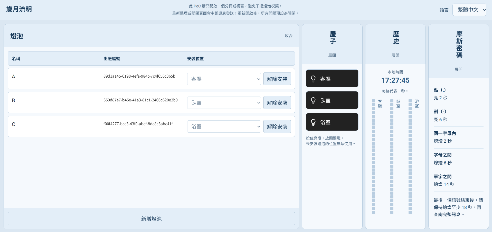
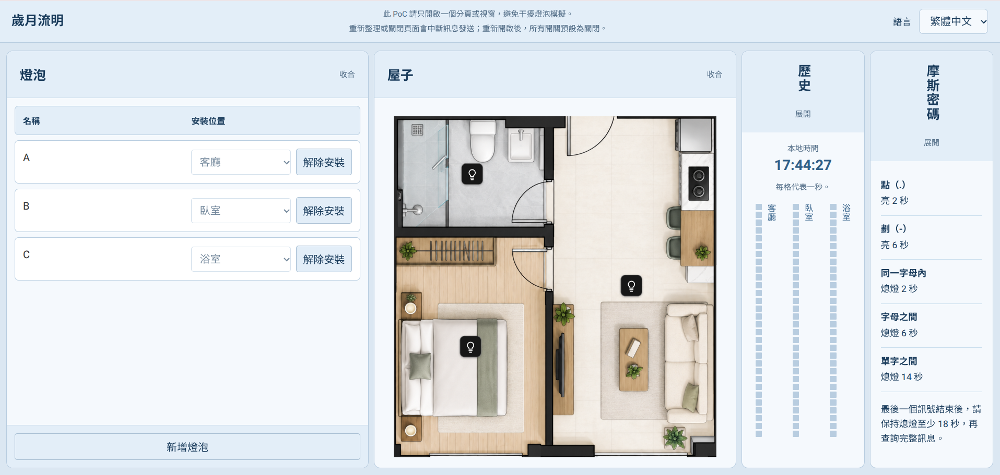
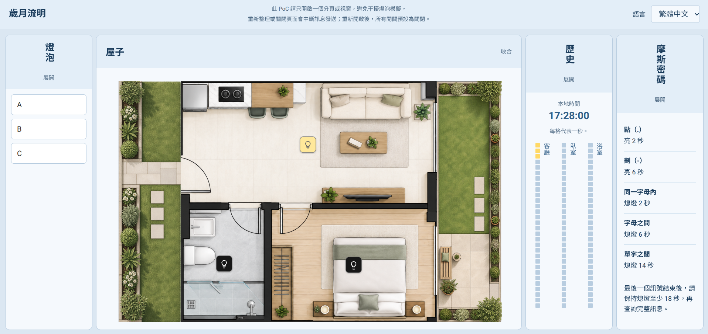
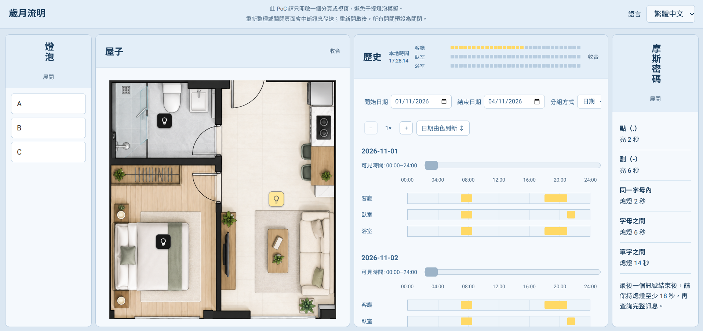
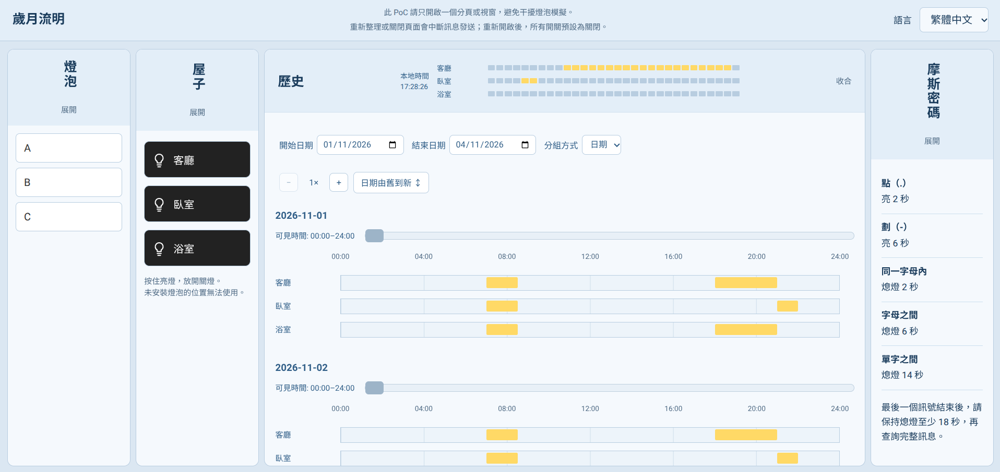
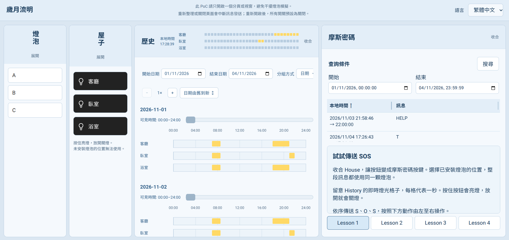
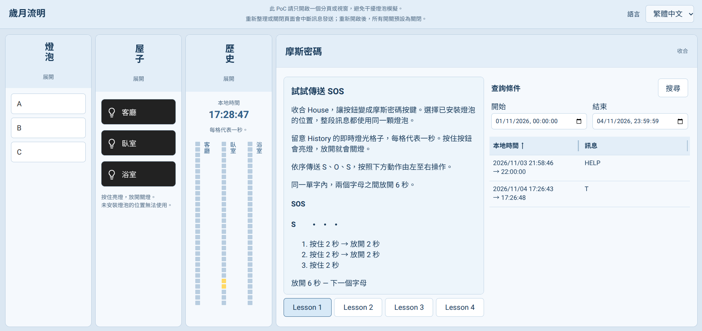
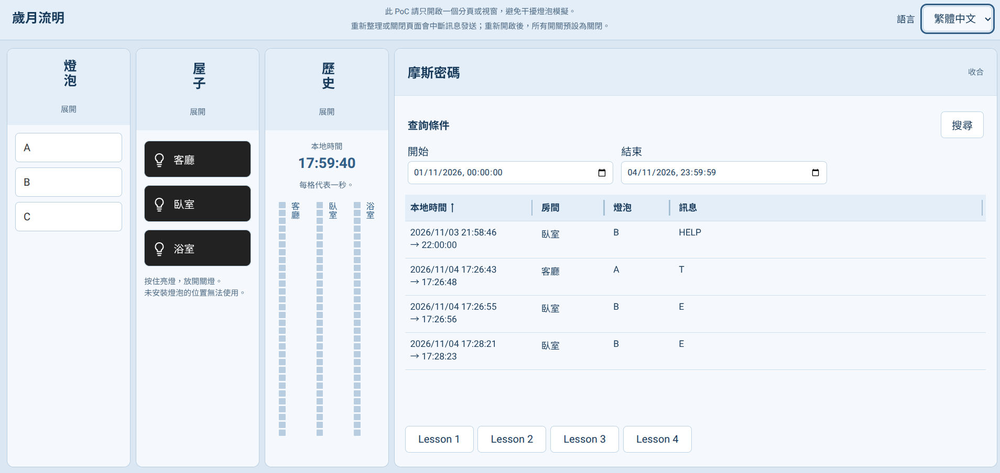

# 歲月流明 — 視覺導覽

[English](VisualGuide.md) | [回到 README](../README.zh-TW.md)

## 操作示範影片

[到 YouTube 觀看中文版操作示範](https://youtu.be/DOmYjJcIi5Y)

> 建議以全螢幕觀看，並將 YouTube 畫質設為 **1080p**，以便看清楚介面文字。

歲月流明是一個以燈光使用紀錄探索居家活動觀察方式的概念驗證專案（PoC）。你可以在瀏覽器中模擬房間的燈光開關、查看使用歷史，也可以嘗試用燈光傳送摩斯密碼。

目前的展示使用軟體模擬，無須連接實體燈泡或感測器。

## 畫面如何組成？

整個應用程式只有一個頁面，依序包含四個可展開與收合的面板：

**燈泡 → 屋子 → 歷史 → 摩斯密碼**

你可以同時展開兩個面板，並排操作與觀察；只展開一個時，它會使用完整寬度。面板的順序保持不變，且至少會保留一個展開的面板。

以下四張截圖分別介紹各個面板，以及它們之間的關係。

## 1. 燈泡：準備要使用的燈

燈泡面板用來管理模擬環境中的燈泡。你可以：

- 新增燈泡，並修改名稱。
- 將燈泡安裝在客廳、臥室或浴室。
- 解除安裝，讓燈泡回到閒置狀態。
- 刪除未安裝且沒有歷史紀錄的燈泡。

每個位置只能安裝一顆燈泡。亮燈中的燈泡不能直接解除安裝；請先關燈，稍等系統確認它已停止活動。

**與其他面板的關係**

這裡的安裝位置會決定「屋子」中哪些房間可以操作燈光。沒有安裝燈泡的房間，其開關無法使用。

新增、安裝、解除安裝或刪除燈泡後，頁面會重新載入，所有燈光會回到關閉狀態。單純修改名稱則不會重新載入頁面。

## 2. 屋子：模擬日常開關燈

屋子面板用平面圖呈現客廳、臥室和浴室。點擊已安裝燈泡的房間開關，就可以模擬開燈與關燈。

你可以依照日常生活的情境操作，例如進入客廳時開燈、離開時關燈，再到臥室開燈。

屋子面板收合時，也提供按住亮燈、放開熄燈的操作方式，方便你練習控制燈光訊號的長短。

**與其他面板的關係**

「燈泡」決定這裡有哪些燈可以使用；你在這裡產生的燈光活動，則會成為「歷史」和「摩斯密碼」可以查詢的資料。

請只使用一個瀏覽器分頁或視窗操作這個 PoC，避免不同視窗的訊號互相干擾。重新載入頁面後，燈光會回到關閉狀態。

## 3. 歷史：查看燈光何時被使用

歷史面板將燈光使用紀錄整理成時間軸，讓你觀察不同位置在什麼時間亮過燈。

你可以：

- 選擇要查看的起始與結束日期。
- 依日期或位置分組。
- 調整時間軸的縮放，並水平捲動查看不同時段。
- 將游標移到紀錄上，查看更詳細的資訊。

若已載入專案提供的示範資料，也可以先從這些紀錄開始探索，不必等待自己累積多天的操作資料。

**與其他面板的關係**

你在「屋子」中的開關燈操作會留下紀錄，之後可以在這裡查詢相應日期。

歷史紀錄保留的是燈光活動發生時的位置。因此，將燈泡移到另一個房間，不會把過去的紀錄一起移到新位置。

這個面板呈現的是燈光使用情況；它本身不會判斷住戶的健康狀態，也不會發送警報。

## 4. 摩斯密碼：把燈光節奏讀成文字

摩斯密碼面板讓你探索另一種使用燈光紀錄的方式：透過亮燈與熄燈的時間長短，表達字母與單字。

面板提供循序漸進的練習，從 SOS、A–Z，到句子與自行輸入訊號。你可以參考教學，在同一個房間操作燈光，再選擇相應的日期與時間範圍，查詢解碼結果。

建議的練習節奏為：

- 點：亮燈 2 秒。
- 劃：亮燈 6 秒。
- 同一字母內的訊號間隔：熄燈 2 秒。
- 字母之間：熄燈 6 秒。
- 單字之間：熄燈 14 秒。

這些間隔是各自適用的完整時間，不需要相加。最後一個訊號結束後，請保持熄燈至少 18 秒，再查詢結果。

**與其他面板的關係**

「屋子」是你輸入燈光訊號的地方；「歷史」讓你查看亮燈時段；「摩斯密碼」則嘗試從這些紀錄中辨識文字。

若已載入示範資料，也可以查詢其中預先安排的 HELP 訊號。這是一項解碼示範，不會實際呼叫救援或通知其他人。

## 接下來可以做什麼？

- 想在自己的電腦上操作：[使用指南](UserGuide.zh-TW.md)
- 想了解前後端結構與技術：[專案結構介紹](StructureIntro.zh-TW.md)
- 想了解專案的起源與開發過程：[開發日誌](DevJournal.zh-TW.md)